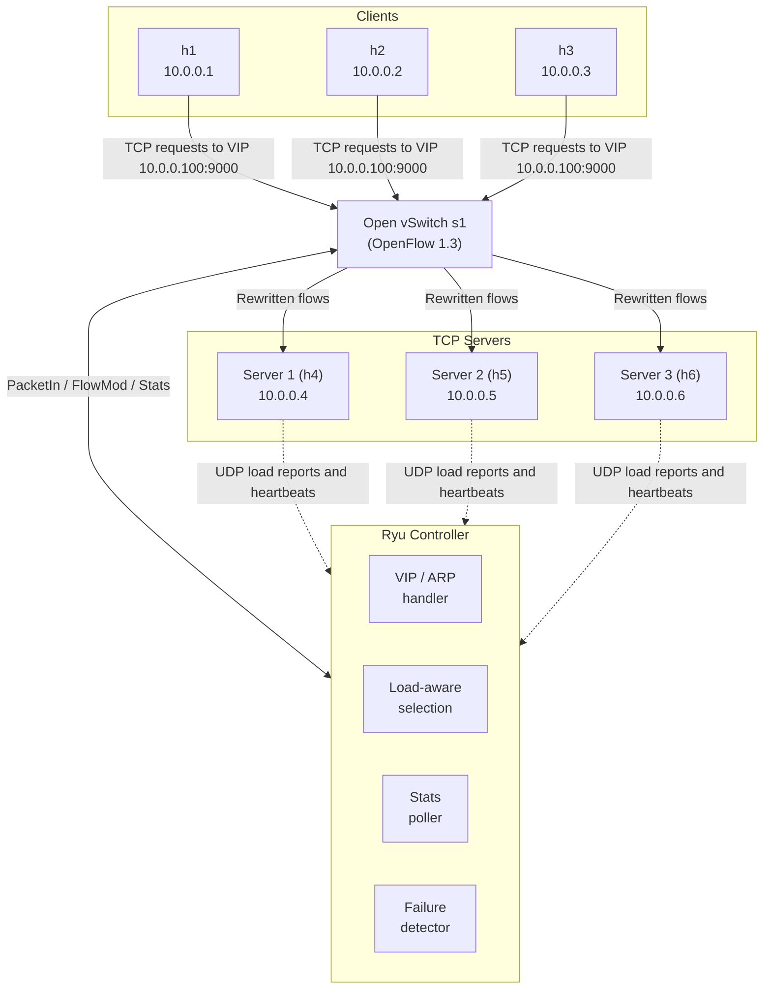
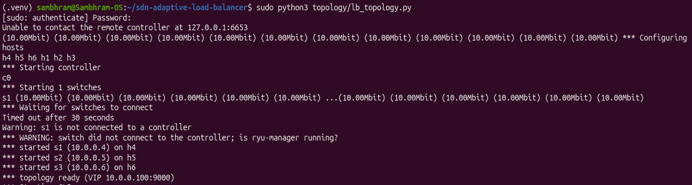
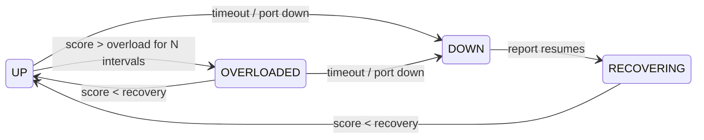
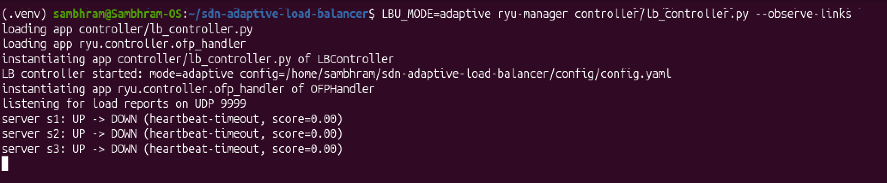
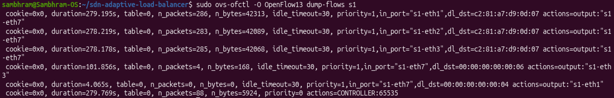

<h1 align="center">SDN Adaptive Load Balancer</h1>

<p align="center">
  <b>Dynamic TCP Load Balancing using Mininet, Ryu (OpenFlow 1.3) and Python Sockets</b><br>
  UE25CS243A – Computer Networks · Jackfruit Mini Project<br>
</p>

| | |
|---|---|
| **Team Number** | 5 |
| **Project Number** | 20 |
| **Semester / Academic Year** | III / 2026–27 |

| Name | SRN | Section |
|---|---|---|
| Sambhram Laxman Sattigeri | PES1UG25AM516 | CSE (AI & ML) "I" |
| Sanidhi | PES1UG25AM544 | CSE (AI & ML) "I" |
| Bandla Samhith | PES1UG25AM559 | CSE (AI & ML) "I" |

---

## Table of Contents

- [Abstract](#abstract)
- [1. Introduction](#1-introduction)
- [2. System Architecture](#2-system-architecture)
- [3. Design and Methodology](#3-design-and-methodology)
- [4. Implementation](#4-implementation)
- [5. Testing and Verification](#5-testing-and-verification)
- [6. Performance Evaluation and Results](#6-performance-evaluation-and-results)
- [7. Conclusion and Future Work](#7-conclusion-and-future-work)
- [References](#references)
- [Appendix A: Team Contributions](#appendix-a-team-contributions)
- [Appendix B: Additional Screenshots](#appendix-b-additional-screenshots)
- [Appendix C: Setup and Troubleshooting](#appendix-c-setup-and-troubleshooting)

---

## Abstract

Static load balancers such as round-robin distribute requests without regard to the real state of the servers or the network, so a slow, congested or failed server continues to receive traffic. This project implements an *adaptive* TCP load balancer on a Software-Defined Network. Three multi-threaded Python socket servers sit behind a virtual IP address (VIP). A Ryu OpenFlow 1.3 controller selects a backend for every new flow using a weighted score of active connections, server CPU usage and link utilisation, installs rewrite flows on an Open vSwitch switch, marks servers as overloaded or down using threshold, hysteresis and heartbeat logic, and redirects traffic accordingly. The system is emulated in Mininet and compared against a static round-robin baseline using response time, throughput, failure rate and load distribution. Both modes are evaluated under normal load, a deliberately slowed server, increasing client concurrency, a mid-run server failure and background link congestion, and the results are presented as tables and graphs.

---

## 1. Introduction

### 1.1 Background

Modern services run on several identical servers, and a load balancer spreads client requests across them. Traditional hardware balancers are closed boxes with fixed algorithms. Software-Defined Networking (SDN) separates the control plane from the data plane: a logically centralised controller programs the switches through a protocol such as OpenFlow, and can observe the whole network while doing so. This makes it possible to build a load balancer whose policy is ordinary software and whose decisions use live network and server measurements.

### 1.2 Problem Statement

Create multiple TCP application servers and dynamically distribute client traffic based on server and network load.

A static policy ignores the actual state of the system. If one server is slow, overloaded or has failed, round-robin keeps sending traffic to it, which increases latency and causes failed requests. The problem is to build and evaluate a controller that observes server load and network load and steers new flows accordingly.

### 1.3 Objectives

| # | Objective | Implemented in |
|---|---|---|
| 1 | Implement multiple TCP servers | `servers/tcp_server.py` |
| 2 | Generate concurrent client requests | `clients/client_generator.py` |
| 3 | Monitor server load | `monitoring/server_reporter.py`, controller |
| 4 | Monitor network load | Controller port-statistics polling |
| 5 | Distribute flows using SDN | `controller/lb_controller.py` |
| 6 | Detect overloaded servers | Threshold + hysteresis logic in controller |
| 7 | Detect server failures | Heartbeat timeout and port-down events |
| 8 | Compare static vs adaptive | `tests/run_comparison.sh`, `results/` |

### 1.4 Scope and Tools

- Emulation: Mininet 2.3.0 with Open vSwitch; Controller: Ryu 4.34 (OpenFlow 1.3); Language: Python 3.
- Servers and clients use plain TCP sockets (`socket`, `socketserver`, `threading`).
- Evaluation: custom client generator, `iperf3` for background congestion, `pandas`/`matplotlib` for analysis.

---

## 2. System Architecture

### 2.1 Topology

The emulated network has one Open vSwitch (`s1`), three clients (`h1`–`h3`) and three TCP servers (`h4`–`h6`). Clients send requests to the VIP `10.0.0.100:9000`; the controller rewrites each flow to one real server. A root-namespace interface (`10.0.0.254`) lets servers send UDP load reports to the controller.



*Figure 2.1: System architecture.*

### 2.2 Components

| Component | Description |
|---|---|
| **Clients (h1–h3)** | Generate many concurrent short TCP requests to the VIP. Each request opens a new connection, so every request exercises the controller's selection logic. |
| **Servers (h4–h6)** | Multi-threaded TCP servers. Each simulates service time (sleep) and CPU work (busy loop) per request and publishes its load statistics. |
| **Reporters** | One per server; sends a UDP report (active connections, CPU %, average service time) every second. A missing report is treated as a missed heartbeat. |
| **Open vSwitch** | Forwards packets and applies the rewrite actions installed by the controller. |
| **Ryu controller** | Chooses backends, installs flows, polls port statistics, and detects overload and failure. |

### 2.3 Switch Port and Address Plan

| Host | Role | IP | Switch port |
|---|---|---|---|
| h4 | Server s1 | 10.0.0.4 | 1 |
| h5 | Server s2 | 10.0.0.5 | 2 |
| h6 | Server s3 | 10.0.0.6 | 3 |
| h1, h2, h3 | Clients | 10.0.0.1–3 | 4, 5, 6 |
| root namespace | Controller report address | 10.0.0.254 | 7 |
| – | Virtual IP (VIP) | 10.0.0.100 (MAC 00:00:00:00:01:00) | – |

*Table 2.1: Addressing and port assignment.*



*Figure 2.2: Mininet topology started with `lb_topology.py`.*

> **Explanation.** The terminal output lists the hosts, the switch and the links created by Mininet (every link is limited to 10 Mbit/s), followed by messages showing that servers s1–s3 and their load reporters were started automatically on h4–h6. The final "topology ready" line confirms that the switch connected to the controller and that the virtual IP 10.0.0.100:9000 is available to the clients.

---

## 3. Design and Methodology

### 3.1 Flow Distribution

1. A client opens a TCP connection to the VIP. Because the VIP has no real host, the controller answers the client's ARP request with the virtual MAC.
2. The first packet (SYN) misses the flow table and is sent to the controller as a `PacketIn`.
3. The controller selects a backend with the active policy (static or adaptive).
4. It installs a *forward* flow (client → VIP rewritten to client → server: `SET_FIELD` on destination MAC and IP) and a *reverse* flow (server → client with source rewritten back to the VIP). Later packets of the connection are forwarded in the switch without involving the controller.
5. Flows use an idle timeout of 10 s and a hard timeout of 60 s, and carry a cookie identifying the server so all flows of a failed server can be deleted at once.

Non-VIP traffic (ARP between hosts, UDP reports) is handled by a simple learning-switch behaviour.

### 3.2 Load Monitoring

**Server load.** Each server's reporter sends a small JSON datagram every `report_interval` seconds with the number of active connections, the CPU usage of the server process and its recent average service time.

**Network load.** The controller sends `OFPPortStatsRequest` every `stats_interval` seconds. Link utilisation of a server port is the larger of the receive and transmit rates divided by the link capacity (full duplex).

### 3.3 Adaptive Selection

Every server receives a score in [0, 1]:

$$
\text{score}_i = w_1\,\min\!\Big(1,\tfrac{c_i+p_i}{C_{max}}\Big) + w_2\,\min\!\Big(1,\tfrac{\text{cpu}_i}{100}\Big) + w_3\,\min(1,u_i)
$$

where $c_i$ is the last reported number of active connections, $p_i$ the number of flows assigned since that report (so that a burst of new flows between reports does not all land on the same server), $u_i$ the link utilisation and $C_{max}$ the connection count that maps to a normalised value of 1. Defaults are $w_1=0.4$, $w_2=0.3$, $w_3=0.3$ and $C_{max}=10$. New flows go to the *lowest-score* server among those in state `UP`; ties are broken by rotating the starting index.

### 3.4 Overload Detection with Hysteresis

A server is moved to `OVERLOADED` when its score exceeds the *overload* threshold for *consecutive_intervals* successive statistics intervals, and returns to `UP` only when its score falls below the lower *recovery* threshold. The gap between the two thresholds prevents flapping. An overloaded server receives no new flows (existing flows are left alone); if every live server is overloaded the controller still uses the best of them rather than dropping traffic.

### 3.5 Failure Detection and Recovery

A server becomes `DOWN` if no load report arrives within `failure_timeout` seconds, or if a `PortStatus` message reports its link down. When this happens the controller deletes every flow whose cookie belongs to that server, so the next connection attempts are redirected to healthy servers. When reports resume (and the link is up) the server enters `RECOVERING` and returns to `UP` once its score is below the recovery threshold.



*Figure 3.1: Server state machine used by the adaptive controller.*

### 3.6 Static Baseline

With `LB_MODE=static` the controller uses plain round-robin and ignores load, overload and failures. It is the baseline against which the adaptive policy is compared.

---

## 4. Implementation

### 4.1 Repository Structure

```
sdn-adaptive-load-balancer/
├── README.md
├── requirements.txt
├── config/
│   └── config.yaml             # VIP, servers, weights, thresholds
├── topology/
│   └── lb_topology.py          # Mininet topology + auto-start of servers
├── controller/
│   └── lb_controller.py        # Ryu app (static + adaptive)
├── servers/
│   └── tcp_server.py           # multi-threaded TCP server
├── clients/
│   └── client_generator.py     # concurrent client workload
├── monitoring/
│   └── server_reporter.py      # load reports to the controller
├── tests/
│   ├── test_basic.sh
│   ├── test_overload.sh
│   ├── test_failure.sh
│   └── run_comparison.sh
├── results/
│   └── plot_results.py         # tables and graphs
└── docs/                       # logo and all screenshots / graphs used in this README
```

### 4.2 Module Description

| Module | Description |
|---|---|
| `tcp_server.py` | `ThreadingMixIn` TCP server. Protocol: client sends `REQ <id>`, server answers `OK <server> <id> <ms>`. Per-request busy-loop and sleep emulate CPU and service time and can be changed at run time through a control file to throttle a server. Publishes active connections and average service time to a stats file. |
| `server_reporter.py` | Reads the server's stats file, measures the server process CPU with `psutil` and sends a UDP report to the controller. If the server is dead or its stats are stale it stays silent, which triggers the failure timeout. |
| `client_generator.py` | Spawns *N* threads; each repeatedly connects to the VIP, sends a request, records the reply latency, status and answering server, then waits a short think time. Writes a per-request CSV and a JSON summary (average, p50, p95, p99, throughput, per-server counts). |
| `lb_topology.py` | Builds the Mininet network with bandwidth-limited links, attaches the root-namespace interface, starts servers and reporters and exports host PIDs for the test scripts. |
| `lb_controller.py` | Contains a pure-Python policy class (scoring, selection, overload and failure state machine) and the Ryu application (ARP for the VIP, flow installation, port statistics, report listener, failure loop, CSV logging). |
| `plot_results.py` | Aggregates the CSV files and produces the summary table and graphs. |

### 4.3 Key Code Excerpts

**Backend selection (adaptive mode).**

```python
def select(self):
    ...
    for wanted in (UP, OVERLOADED, RECOVERING):   # best tier that has members
        pool = [s for s in self.servers if s.status == wanted]
        if pool: break
    order = [self.servers[(self.rr + i) % n] for i in range(n)]
    s = None
    for c in order:                               # lowest score wins
        if c in pool and (s is None or self.score(c) < self.score(s)):
            s = c
    s.pending += 1
```

**Rewrite flows installed per connection.**

```python
fwd_act = [SetField(eth_dst=srv.mac), SetField(ipv4_dst=srv.ip), Output(srv.port)]
rev_act = [SetField(eth_src=VIP_MAC), SetField(eth_dst=client_mac),
           SetField(ipv4_src=VIP), Output(in_port)]
```

### 4.4 Configuration

`config/config.yaml` (excerpt):

```yaml
vip: 10.0.0.100
service_port: 9000
monitoring:  {stats_interval: 2, report_interval: 1, failure_timeout: 5}
thresholds:  {overload: 0.55, recovery: 0.35, consecutive_intervals: 3}
weights:     {connections: 0.4, cpu: 0.3, link_utilization: 0.3}
normalization: {max_connections: 10, link_capacity_mbps: 10}
flow:        {idle_timeout: 10, hard_timeout: 60}
```

*Note on thresholds.* With weights 0.4/0.3/0.3 and each term capped at 1, a server that is slow on connections and CPU but has an idle link reaches only about 0.7, so a threshold of 0.80 would never trigger. The overload and recovery thresholds were therefore set to 0.55 and 0.35.

### 4.5 Running the Project

Open three terminals from the repository root.

```bash
# Terminal 1 - controller (mode chosen with an environment variable)
LB_MODE=adaptive ryu-manager controller/lb_controller.py --observe-links

# Terminal 2 - topology (also starts the servers and reporters)
sudo python3 topology/lb_topology.py

# Mininet CLI - traffic
mininet> h1 python3 clients/client_generator.py --vip 10.0.0.100 --port 9000 --clients 50 --duration 60

# Inspect flows
sudo ovs-ofctl -O OpenFlow13 dump-flows s1
```

For the static baseline start the controller with `LB_MODE=static`.



*Figure 4.1: Ryu controller log in adaptive mode.*

> **Explanation.** The first lines show the active mode (static or adaptive) and the UDP port on which the controller listens for load reports. Each later line of the form "server s2: UP → DOWN (heartbeat-timeout, score=…)" is a state change produced by the overload or failure logic; the reason shows whether it came from the score threshold, a missed heartbeat or a port-down event.



*Figure 4.2: Flow table of `s1` showing forward and reverse rewrite flows.*

> **Explanation.** Flows with priority 10 are the per-connection load-balancing rules. The forward rule matches the client address, the VIP and the TCP ports and applies `set_field` actions on the destination MAC and IP before outputting to the chosen server port; the reverse rule rewrites the source back to the VIP. The cookie of each flow equals the server index plus one, which lets the controller delete all flows of a failed server at once. Priority-1 entries are learned layer-2 rules and the priority-0 table-miss entry sends unmatched packets to the controller.

---

## 5. Testing and Verification

| ID | Scenario | Procedure | Expected result |
|---|---|---|---|
| T1 | Basic connectivity | `tests/test_basic.sh` | All clients reach the VIP and are answered |
| T2 | Even distribution | 50 clients, equal servers | Roughly equal requests per server |
| T3 | Server overload | `tests/test_overload.sh` (throttle s1) | s1 marked OVERLOADED; new flows avoid it |
| T4 | Server failure | `tests/test_failure.sh` (kill s2) | Detected within the failure timeout; traffic moves to s1, s3 |
| T5 | Recovery | Restart s2 | s2 returns to the pool |
| T6 | Link congestion | Background `iperf3` to one server | Fewer new flows on the congested path |
| T7 | Static vs adaptive | `tests/run_comparison.sh` | Adaptive: lower latency, fewer failures |

*Table 5.1: Test cases.*

### 5.1 Pass Criteria Checked by the Test Scripts

| ID | Criterion (printed as PASS/FAIL by the script) |
|---|---|
| T1 | Every client host receives replies and fewer than 1% of requests fail. |
| T2 | All three servers answer and none serves more than half of the requests (otherwise a warning is printed). |
| T3 | s1 reaches OVERLOADED after being throttled and its share of requests more than 15 s later is lower than before. |
| T4 | s2 reaches DOWN and serves no requests from 8 s after the failure until it is restored. |
| T5 | s2 returns to UP after being restarted. |
| T6, T7 | Compared through the generated summary table and graphs (no automatic verdict). |

*Table 5.2: Pass criteria for the test cases.*

`test_basic.sh`, `test_overload.sh` and `test_failure.sh` expect the controller and topology to be running; `run_comparison.sh` starts and stops both itself.


*Figure 5.1: Output of `test_basic.sh` (T1/T2).*

> **Explanation.** For every client host the script prints the number of successful and failed requests, the average and 95th-percentile latency and the servers that answered. The combined distribution line shows how many requests each of s1, s2 and s3 served, and the final PASS/FAIL line is the verdict of T1 (every host received replies and fewer than 1% of requests failed).


*Figure 5.2: Output of `test_overload.sh` (T3).*

> **Explanation.** The script starts load from three clients, throttles s1 ten seconds into the run (300 ms delay and 30 ms of CPU work per request) and then prints s1's share of requests before the throttle and more than 15 s after it, together with the controller events that followed. An OVERLOADED event for s1 and a lower share afterwards show that the controller steered new flows away from the slowed server.


*Figure 5.3: Output of `test_failure.sh` (T4/T5).*

> **Explanation.** The script fails s2 ten seconds into the run and restores it after 28 s, then prints the number of requests, failed requests and requests served by s2 in three phases, followed by the detection time and the recovery time. Failed requests are only expected in the short window before the controller detects the failure and removes the flows to s2.

---

## 6. Performance Evaluation and Results

### 6.1 Experimental Setup

All experiments ran in Mininet 2.3.0 on an Ubuntu Linux virtual machine with Open vSwitch and Ryu 4.34. Links were limited to 10 Mbit/s. Each scenario was run twice (static and adaptive) for 30 s with 50 clients unless stated.

1. **Normal load** – three equal servers.
2. **Heterogeneous servers** – server s2 slowed (150 ms delay, extra CPU work).
3. **Concurrency** – 10, 50 and 100 clients.
4. **Server failure** – s2 killed one third of the way into the run.
5. **Congestion** – `iperf3` traffic saturating the link to s1.

**Metrics:** average and 95th-percentile response time, throughput (requests/s), failed-request rate, per-server load distribution, failure detection time and controller overhead (PacketIn rate).

Run everything and generate the tables and graphs:

```bash
sudo bash tests/run_comparison.sh     # runs all scenarios, then calls plot_results.py
python3 results/plot_results.py       # regenerate tables/graphs from results/runs/
```

### 6.2 Summary Table

The values are produced by `plot_results.py` (file `results/summary.md`) after running `tests/run_comparison.sh`; the dashes are replaced by the measured numbers.

| Scenario | Metric | Static | Adaptive | Improvement |
|---|---|---:|---:|---:|
| Normal load | Avg response time (ms) | – | – | – % |
| One slow server | 95th pct latency (ms) | – | – | – % |
| Server failure | Failed requests (%) | – | – | – % |
| High concurrency | Throughput (req/s) | – | – | – % |
| Congestion | Avg response time (ms) | – | – | – % |

*Table 6.1: Static versus adaptive comparison.*

### 6.3 Graphs


*Figure 6.1: Average and 95th-percentile response time, static vs adaptive.*

> **Explanation.** The left panel shows the average and the right panel the 95th-percentile response time for each scenario (grey: static, blue: adaptive); lower is better. With equal servers the two policies are expected to behave similarly. When a server is slowed, congested or failed, its score rises (or it is marked DOWN), so the adaptive policy sends fewer new flows to it, which is where a difference between the bars appears.


*Figure 6.2: Per-server share of served requests in each scenario.*

> **Explanation.** Each bar shows the percentage of successfully served requests handled by each server. Round-robin gives each server about one third of the requests by construction, regardless of its state. The adaptive bars deviate from an even split when the servers differ, because load is moved away from the slowed, congested or failed server.


*Figure 6.3: Controller state-change events (`controller_events.csv`) during the failure run.*

> **Explanation.** Each row of the events file records the time, the server, the old and new state and the reason. In the failure run, the delay between the moment s2 is killed and the first DOWN event for s2 is the detection time; it is bounded by the 5 s failure timeout plus the 0.5 s period of the failure check.

### 6.4 Controller Overhead

Because every new TCP connection triggers one `PacketIn`, controller load grows with the connection rate. The controller logs its cumulative PacketIn count every statistics interval (`*_stats.csv`), and `plot_results.py` converts it to a rate per scenario. Since the load generators open a new connection for every request, the PacketIn rate is close to the request rate, and this is the main cost of reactive per-flow balancing. Reducing it would require longer-lived connections or proactive wildcard rules.

### 6.5 Discussion

With identical, lightly loaded servers the scores are almost equal and the adaptive policy behaves like round-robin, so little difference is expected. The benefit appears when servers differ: a slowed server accumulates active connections and CPU load, its score rises, and new flows go to the other servers. The flows-assigned-since-last-report counter prevents all new flows from landing on the momentarily best server between two reports.

The reaction time of the adaptive policy is governed by its monitoring parameters. Load reports arrive every second and port statistics every two seconds, and an overload is declared only after three consecutive intervals, so the controller reacts within a few seconds rather than instantly; this trades speed for stability. A failed server is detected when no report has arrived for the five-second timeout (or immediately on a port-down event), so requests sent to it in that window can time out. Static round-robin never detects the failure and keeps losing one third of new connections.

The experiment has limits. Emulated hosts share the CPU of one machine, so CPU readings and timings are approximate, the servers are synthetic (sleep and busy loop), and results depend on the chosen weights and thresholds.

---

## 7. Conclusion and Future Work

### 7.1 Conclusion

The project built an SDN-based TCP load balancer in which a Ryu controller combines server-side metrics (connections, CPU) and network-side metrics (link utilisation) to choose a backend per flow, shields overloaded servers using hysteresis, and detects failures through heartbeats and port events. The comparison with a static round-robin baseline demonstrates how an SDN controller can use live server and network measurements to make better per-flow decisions, and shows the trade-offs of reactive balancing: monitoring delay, controller load and the need to tune thresholds.

### 7.2 Limitations

- Selection is per connection at the first packet; long-lived flows are not migrated.
- The controller is a single point of failure and every new connection costs one PacketIn.
- Emulated hosts share the CPU of the host machine, so CPU readings are approximate.
- Scores use fixed weights and thresholds that were tuned by hand.

### 7.3 Future Work

- Learn weights automatically or use latency-based feedback.
- Proactive wildcard rules or multiple controllers to reduce controller load.
- Support UDP and HTTP-aware (layer-7) balancing; session persistence.
- A web dashboard to show live load and the static-versus-adaptive comparison.

---

## References

1. Mininet Project, *Mininet: An Instant Virtual Network on your Laptop*. <https://mininet.org>
2. Ryu SDN Framework. <https://ryu-sdn.org>
3. Open Networking Foundation, *OpenFlow Switch Specification, Version 1.3.x*.
4. Open vSwitch documentation. <https://www.openvswitch.org>
5. S. L. Sattigeri et al., *sdn-adaptive-load-balancer* (source code). <https://github.com/Sambhram1087/sdn-adaptive-load-balancer>
6. Course material: Computer Networks (UE25CS243A), SDN and Socket Programming guidelines, PES University.

---

## Appendix A: Team Contributions

| Member | Contribution |
|---|---|
| Sambhram L. Sattigeri (PES1UG25AM516) | Mininet topology, TCP servers, test scripts |
| Sanidhi (PES1UG25AM544) | Monitoring, performance evaluation, documentation |
| Bandla Samhith (PES1UG25AM559) | Ryu controller logic and load-balancing policy |

## Appendix B: Additional Screenshots


*Figure B.1: Per-port counters of `s1` (`ovs-ofctl dump-ports`).*

> **Explanation.** The receive and transmit counters of ports 1–3 show how much traffic each server link carried. These are the same counters the controller polls every two seconds to compute link utilisation.

## Appendix C: Setup and Troubleshooting

**Prerequisites:** Ubuntu 20.04/22.04, Python 3.8+ (Ryu works best on 3.8/3.9), Mininet 2.3.0, Open vSwitch 2.13+, Ryu 4.34.

```bash
git clone https://github.com/Sambhram1087/sdn-adaptive-load-balancer.git
cd sdn-adaptive-load-balancer
sudo apt update && sudo apt install -y mininet openvswitch-switch python3-pip iperf3
pip3 install -r requirements.txt
sudo mn --test pingall          # verify Mininet
```

| Problem | Fix |
|---|---|
| `Cannot connect to controller` | Start `ryu-manager` (port 6653) before the topology. |
| Stale Mininet state | `sudo mn -c` |
| Ryu import errors | Use Python 3.8/3.9 or a virtualenv with `eventlet==0.30.2`. |
| No flows installed | `ovs-vsctl set bridge s1 protocols=OpenFlow13` |
| Servers not reporting | Check `monitoring.report_port` in `config/config.yaml` and that no firewall blocks UDP to 10.0.0.254. |
| `--mode` rejected by Ryu | Use the `LB_MODE` environment variable instead. |
