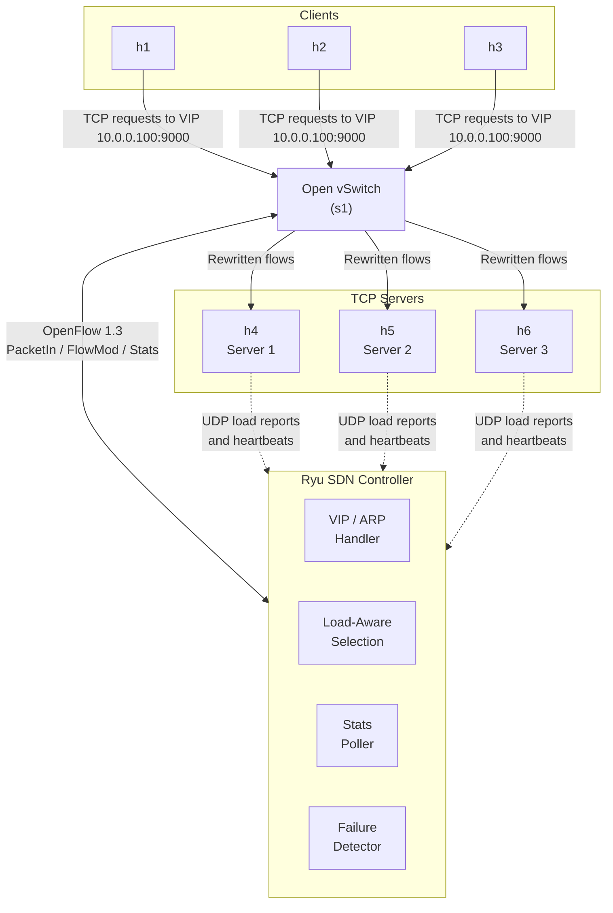

# SDN Adaptive Load Balancer

> Jackfruit Mini Project: SDN + Socket Programming
> Adaptive TCP load balancing using Mininet, an OpenFlow controller (Ryu), and low-level Python sockets.

**Team:** `Sambhram Laxman Sattigeri (PES1UG25AM516)`, `<Name 2 (SRN)>`, `<Name 3 (SRN)>`
**Course / Section:** `Computer Networks(UE25CS243A), CSE (AI & ML) 'I' Section`

---

## Table of Contents

1. [Problem Statement](#1-problem-statement)
2. [Objectives](#2-objectives)
3. [System Architecture](#3-system-architecture)
4. [How It Works?](#4-how-it-works)
5. [Repository Structure](#5-repository-structure)
6. [Prerequisites](#6-prerequisites)
7. [Setup and Installation](#7-setup-and-installation)
8. [Running the Project](#8-running-the-project)
9. [Test Cases](#9-test-cases)
10. [Performance Evaluation](#10-performance-evaluation)
11. [Results](#11-results)
12. [Configuration Reference](#12-configuration-reference)
13. [Troubleshooting](#13-troubleshooting)
14. [Team Contributions](#14-team-contributions)
15. [References](#15-references)

---

## 1. Problem Statement

Create multiple TCP application servers and dynamically distribute client traffic based on server and network load.

A static load balancer (e.g. round-robin) ignores the actual state of the system. If one server is slow, overloaded, or has failed, it keeps sending traffic there. This project builds an **adaptive** load balancer in which an SDN controller observes both **server load** and **network load** and steers new flows accordingly. It is compared against a static baseline.

## 2. Objectives

| # | Objective                           | Where implemented                              |
|---|-------------------------------------|------------------------------------------------|
| 1 | Implement multiple TCP servers      | `servers/tcp_server.py`                        |
| 2 | Generate concurrent client requests | `clients/client_generator.py`                  |
| 3 | Monitor server load                 | `monitoring/server_reporter.py` + controller   |
| 4 | Monitor network load                | Controller port/flow statistics polling        |
| 5 | Distribute flows using SDN          | `controller/lb_controller.py` (OpenFlow rules) |
| 6 | Detect overloaded servers           | Threshold logic in controller                  |
| 7 | Detect server failures              | Heartbeat timeout + port-down events           |
| 8 | Compare static vs adaptive          | `tests/run_comparison.sh`, `results/`          |

## 3. System Architecture



**Components**

- **Clients (h1 to h3):** generate many concurrent TCP requests to a single virtual IP (`10.0.0.100:9000`).
- **Servers (h4 to h6):** multi-threaded TCP servers. Each periodically reports its CPU, active connections, and response latency to the controller.
- **OpenFlow switch (Open vSwitch):** forwards traffic and rewrites destination IP/MAC based on controller rules.
- **Controller (Ryu):** picks a backend per new flow, installs flow rules, polls port statistics, and reacts to overload and failure.

## 4. How It Works

### 4.1 Flow distribution

1. A client opens a TCP connection to the virtual IP `10.0.0.100`.
2. The first packet (SYN) misses the flow table and goes to the controller (`PacketIn`).
3. The controller chooses a backend server using the active policy (static or adaptive).
4. It installs forward and reverse flow rules (with `SET_FIELD` for IP/MAC rewriting) so subsequent packets bypass the controller.

### 4.2 Load monitoring

- **Server load:** each server sends a small UDP report every `report_interval` seconds containing active connections, CPU %, and average service time.
- **Network load:** the controller polls `OFPPortStatsRequest` every `stats_interval` seconds and computes per-port throughput (bytes/s) towards each server.

### 4.3 Adaptive selection

Each server gets a score:

```
score = w1 * norm(active_connections) + w2 * norm(cpu) + w3 * norm(link_utilization)
```

New flows go to the server with the **lowest score**. Weights `w1..w3` are in `config/config.yaml`.

### 4.4 Overload detection

A server is marked **OVERLOADED** when its score exceeds `overload` for `consecutive_intervals` consecutive intervals. It stops receiving new flows until its score drops below `recovery` (hysteresis prevents flapping).

### 4.5 Failure detection

A server is marked **DOWN** if either:

- no heartbeat/load report arrives within `failure_timeout`, or
- the controller receives a `PortStatus` event showing the link is down.

Flows pointing to the failed server are deleted, so new connections are redirected to healthy servers.

### 4.6 Static baseline

`LB_MODE=static` uses plain round-robin and ignores load and failures. This is the baseline for comparison.

## 5. Repository Structure

```
sdn-adaptive-load-balancer/
├── README.md
├── requirements.txt
├── config/
│   └── config.yaml            # thresholds, weights, intervals, VIP
├── topology/
│   └── lb_topology.py         # Mininet topology
├── controller/
│   └── lb_controller.py       # Ryu app (static + adaptive modes)
├── servers/
│   └── tcp_server.py          # multi-threaded TCP server
├── clients/
│   └── client_generator.py    # concurrent client workload
├── monitoring/
│   └── server_reporter.py     # sends load reports to controller
├── tests/
│   ├── test_basic.sh
│   ├── test_overload.sh
│   ├── test_failure.sh
│   └── run_comparison.sh
├── results/                   # CSV logs, graphs
│   └── plot_results.py        # summary tables and plots
└── docs/                      # report, architecture.png, screenshots
```

## 6. Prerequisites

| Software     | Version (tested)                           |
|--------------|--------------------------------------------|
| Ubuntu       | 20.04 / 22.04                              |
| Python       | 3.8+ (Ryu works best on 3.8/3.9)           |
| Mininet      | 2.3.0                                      |
| Open vSwitch | 2.13+                                      |
| Ryu          | 4.34                                       |
| Python libs  | `pyyaml`, `psutil`, `matplotlib`, `pandas` |

## 7. Setup and Installation

```bash
# 1. Clone the repo
git clone https://github.com/Sambhram1087/sdn-adaptive-load-balancer.git
cd sdn-adaptive-load-balancer

# 2. System packages
sudo apt update
sudo apt install -y mininet openvswitch-switch python3-pip iperf3

# 3. Python dependencies
pip3 install -r requirements.txt

# 4. Verify
sudo mn --test pingall
ryu-manager --version
```

## 8. Running the Project

Open **three terminals** from the repo root.

**Terminal 1: start the controller**

Ryu parses its own command line before loading apps, so the mode is chosen with the `LB_MODE` environment variable.

```bash
# Adaptive mode
LB_MODE=adaptive ryu-manager controller/lb_controller.py --observe-links

# Static baseline
LB_MODE=static ryu-manager controller/lb_controller.py
```

**Terminal 2: start the topology**

```bash
sudo python3 topology/lb_topology.py
```

This creates 3 clients, 3 servers, and 1 OVS switch, then starts the servers and load reporters automatically.

**Terminal 3 (or Mininet CLI): generate traffic**

```
mininet> h1 python3 clients/client_generator.py --vip 10.0.0.100 --port 9000 --clients 50 --duration 60
```

**Useful inspection commands**

```bash
sudo ovs-ofctl -O OpenFlow13 dump-flows s1
sudo ovs-ofctl -O OpenFlow13 dump-ports s1
```

## 9. Test Cases

| ID | Scenario           | Steps                                              | Expected result                                                 |
|----|--------------------|----------------------------------------------------|-----------------------------------------------------------------|
| T1 | Basic connectivity | `bash tests/test_basic.sh`                         | All clients reach the VIP; requests are answered by some server |
| T2 | Even distribution  | 50 clients, equal servers (printed by `test_basic.sh`) | Roughly equal request counts per server                     |
| T3 | Server overload    | `bash tests/test_overload.sh` (throttles s1)       | Controller marks it OVERLOADED; new flows avoid it              |
| T4 | Server failure     | Kill `s2` mid-run (`bash tests/test_failure.sh`)   | Detected within `failure_timeout`; traffic shifts to s1/s3      |
| T5 | Recovery           | Restart the failed server (done by `test_failure.sh`) | Server returns to the pool after recovery threshold          |
| T6 | Link congestion    | Add background `iperf3` traffic on one server link (`congestion` scenario of `run_comparison.sh`) | Controller reduces flows sent over the congested path |
| T7 | Static vs adaptive | `bash tests/run_comparison.sh`                     | Adaptive shows lower latency and fewer failed requests          |

`test_basic.sh`, `test_overload.sh` and `test_failure.sh` expect the controller and topology to be running already. `run_comparison.sh` starts and stops both itself.

## 10. Performance Evaluation

**Metrics**

- Average and 95th percentile response time (ms)
- Throughput (requests/s)
- Request failure / timeout rate (%)
- Per-server load distribution (connections per server)
- Failure detection and recovery time (s)
- Controller overhead (PacketIn rate)

**Experimental conditions** (each run for both static and adaptive)

1. Normal load (balanced servers)
2. Heterogeneous servers (one slowed down)
3. High concurrency (e.g. 10, 50, 100 clients)
4. Server failure during run
5. Background congestion on one link

Run everything and generate plots:

```bash
bash tests/run_comparison.sh
python3 results/plot_results.py
```

## 11. Results

> Fill this in after running experiments. `results/summary.md` contains a ready-made table.

| Scenario         | Metric            | Static     | Adaptive   | Improvement |
|------------------|-------------------|------------|------------|-------------|
| Normal load      | Avg response time | `__ ms`    | `__ ms`    | `__ %`      |
| One slow server  | 95th pct latency  | `__ ms`    | `__ ms`    | `__ %`      |
| Server failure   | Failed requests   | `__ %`     | `__ %`     | `__ %`      |
| High concurrency | Throughput        | `__ req/s` | `__ req/s` | `__ %`      |

Graphs are saved in `results/`:


**Observations:** `<Summarize what the graphs show and why adaptive does or does not help.>`

## 12. Configuration Reference

`config/config.yaml`

```yaml
vip: 10.0.0.100
vip_mac: 00:00:00:00:01:00
service_port: 9000
mode: adaptive             # overridden by env LB_MODE=static|adaptive

servers:
  - {name: s1, ip: 10.0.0.4, mac: 00:00:00:00:00:04, port: 1}
  - {name: s2, ip: 10.0.0.5, mac: 00:00:00:00:00:05, port: 2}
  - {name: s3, ip: 10.0.0.6, mac: 00:00:00:00:00:06, port: 3}

monitoring:
  stats_interval: 2          # seconds between port-stats polls
  report_interval: 1         # seconds between server load reports
  failure_timeout: 5         # seconds without report => DOWN
  controller_ip: 10.0.0.254  # root-namespace address that hosts send UDP reports to
  report_port: 9999          # UDP port the controller listens on

thresholds:
  overload: 0.55
  recovery: 0.35
  consecutive_intervals: 3

weights:
  connections: 0.4
  cpu: 0.3
  link_utilization: 0.3

normalization:
  max_connections: 10        # active connections that map to norm = 1.0
  link_capacity_mbps: 10     # must match --bw in topology (default 10)

flow:
  idle_timeout: 10
  hard_timeout: 60
```

## 13. Troubleshooting

| Problem                        | Fix                                                                    |
|--------------------------------|------------------------------------------------------------------------|
| `Cannot connect to controller` | Make sure Ryu is running on port 6653 before starting the topology     |
| Stale Mininet state            | `sudo mn -c`                                                           |
| Ryu import errors              | Use Python 3.8/3.9 or a virtualenv with `eventlet==0.30.2`             |
| No flows installed             | Check OpenFlow version: `ovs-vsctl set bridge s1 protocols=OpenFlow13` |
| Servers not reporting          | Confirm controller listens on `monitoring.report_port` in `config.yaml` and that no firewall blocks UDP on 10.0.0.254 |
| `--mode` rejected by Ryu       | Use the `LB_MODE` environment variable instead                         |

## 14. Team Contributions

| Member     | Contribution                                      |
|------------|---------------------------------------------------|
| `<Name 1>` | Topology, TCP servers, test scripts               |
| `<Name 2>` | Controller logic, load-balancing policy           |
| `<Name 3>` | Monitoring, performance evaluation, documentation |

## 15. References

- Mininet documentation: https://mininet.org
- Ryu SDN Framework: https://ryu-sdn.org
- OpenFlow Switch Specification v1.3
- Course materials: SDN-Socket Programming guidelines
